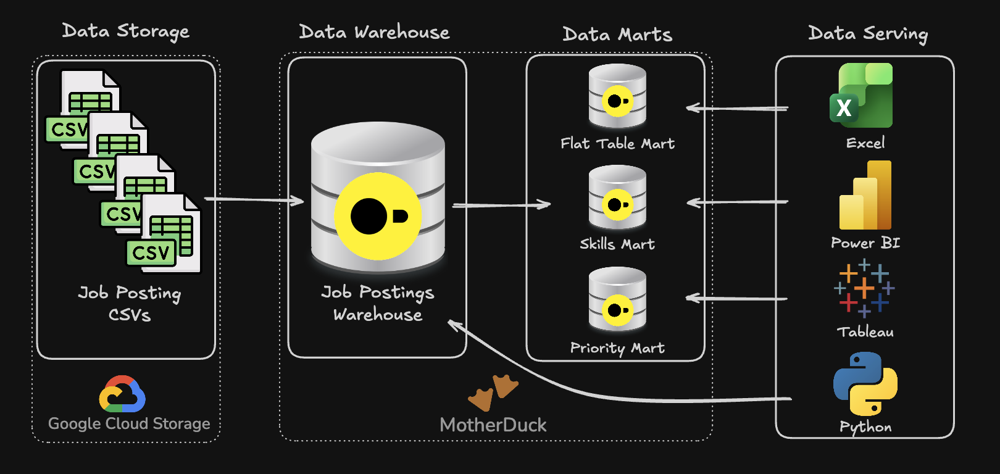

# 🛠️ SQL Data Engineering Projects

Hi, I'm **Muhammad Atif** 👋 — this repository is my portfolio of hands-on SQL data engineering projects. It covers the full workflow from **exploratory analysis** of a job market data warehouse, to building a **production-style ETL pipeline** with a star schema and data marts, to **transforming flat data** into a normalized warehouse.

## 📁 Table of Contents

### [Projects](Projects/)

- [**Project #1:** Exploratory Data Analysis](Projects/1_EDA/) — Job market analytics with SQL
- [**Project #2:** Data Warehouse & Mart Build](Projects/2_WH_Mart_Build/) — Production ETL pipeline from raw CSVs to star schema and data marts
- [**Project #3:** Flat to Warehouse Build](Projects/3_Flat_to_WH_Build/) — Transform flat job posting data into a normalized star schema



## 🧰 Tech Stack

- 🐤 **DuckDB / MotherDuck** — OLAP database and cloud data warehouse
- 🧮 **SQL** — DDL, DML, CTEs, window functions, `MERGE` upserts
- 📊 **Dimensional Modeling** — star schema, fact / dimension / bridge tables, data marts
- ☁️ **Google Cloud Storage** — source CSV files
- 🛠️ **VS Code + Terminal** — development and DuckDB CLI execution
- 📦 **Git & GitHub** — version control

## ▶️ How to Run SQL

### Option 1: Cloud — MotherDuck

1. Sign up for a free [MotherDuck](https://motherduck.com/) account
2. Use **MotherDuck Studio** in your browser — no installation required
3. Attach the job postings database:

```sql
ATTACH 'md:_share/data_jobs/87603155-cdc7-4c80-85ad-3a6b0d760d93'
```

> The cloud UI works like a notebook (run queries cell-by-cell). To run full project files, use Option 2.

### Option 2: Run Locally with DuckDB

1. **Install DuckDB** from the [MotherDuck install page](https://motherduck.com/docs/getting-started/interfaces/connect-query-from-duckdb-cli/)
2. **Launch DuckDB** in your terminal:

   ```bash
   duckdb
   ```

3. **Attach and use the database:**

   ```sql
   ATTACH 'md:_share/data_jobs/87603155-cdc7-4c80-85ad-3a6b0d760d93';
   USE data_jobs;
   ```

4. **Run project files:** follow the instructions in each [project folder](Projects/).

## 🙌 Acknowledgements

These projects were built while following the free [SQL for Data Engineering](https://youtu.be/UjhFbq4uU2Y) course by Luke Barousse. Job postings data was collected using [SerpApi](https://serpapi.com/).

## 📬 Connect With Me

- **GitHub:** [atifkhan215](https://github.com/atifkhan215)
